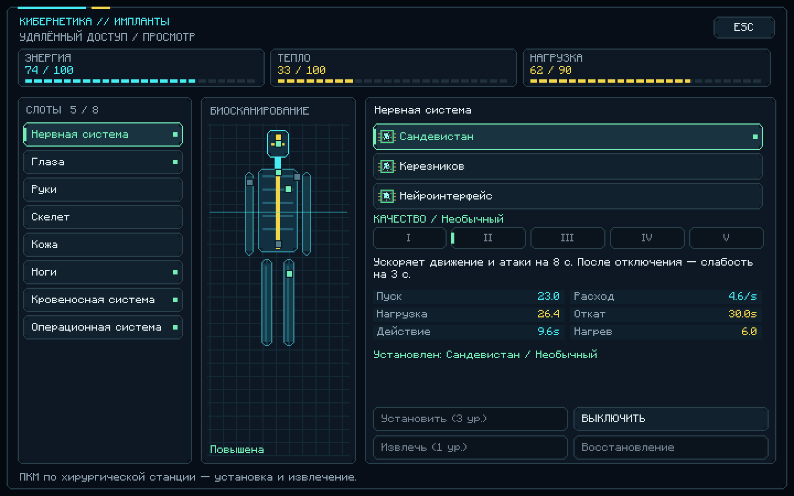

# Cybernetic Augmentation 0.2.0

Мод для **Minecraft 1.21.1 + NeoForge 21.1.259**, нужна **Java 21**.

## Скачать обновление

- [Скачать JAR 0.2.0](https://github.com/fogcer23-ctrl/Modminetcraftsuperpupercyberpuck/raw/refs/heads/downloads/cybernetic_augmentation-0.2.0.jar)
- [Скачать ZIP с тем же JAR и инструкцией](https://github.com/fogcer23-ctrl/Modminetcraftsuperpupercyberpuck/raw/refs/heads/downloads/cybernetic_augmentation-0.2.0-download.zip)

**Удалите старый JAR 0.1.0 из `mods`, затем положите новый файл. Не устанавливайте две версии одновременно.** Для сервера обновите одинаковый JAR на клиенте и сервере. Формат сохранений игрока не изменён.

## Исправления и новый дизайн

- Исправлено размытие текста: интерфейс больше не попадает под фоновое размытие Minecraft после отрисовки.
- Собственные угловатые кнопки, тёмные панели, неоновые акценты, биосканирование, индикаторы занятых слотов.
- Чёткий текст в штатном масштабе GUI; компактный режим с корректной прокруткой, ограничением кликов и сохранением фокуса клавиатуры.
- Подсказки объясняют недоступные действия: нужна станция, предмет, опыт, энергия, свободный слот или завершение отката.
- HUD показывает время активной способности отдельно от перезарядки, готовность модулей и актуальную клавишу управления.

[Компактный экран](preview-0.2.0-compact.png) · [Превью HUD](preview-0.2.0-hud.png)

Это реальные снимки графического клиента с демонстрационными состояниями имплантов, без входа в игровой мир.

## Как играть

**K** — управление имплантами; ПКМ по хирургической станции — установка и извлечение. R — нервная система, V — оптика, G — ноги, H — маскировка. 23 типа имплантов пяти уровней качества, хирургическая станция, энергия, перегрев, активные способности и HUD. Все рецепты и полная инструкция входят в ZIP.

## Проверки

Сборка успешна. **70 модульных тестов**, **6 игровых серверных тестов**, графические проверки ввода и **8 снимков** на масштабах GUI 1/2/3 прошли. Ручная игра в мире, длительная игра и несколько настоящих клиентов ещё не проверены. Контрольные суммы — в `SHA256SUMS.txt`.

## Архив

[Версия 0.1.0, JAR](https://github.com/fogcer23-ctrl/Modminetcraftsuperpupercyberpuck/raw/refs/heads/downloads/cybernetic_augmentation-0.1.0.jar) · [Версия 0.1.0, ZIP](https://github.com/fogcer23-ctrl/Modminetcraftsuperpupercyberpuck/raw/refs/heads/downloads/cybernetic_augmentation-0.1.0-download.zip)
