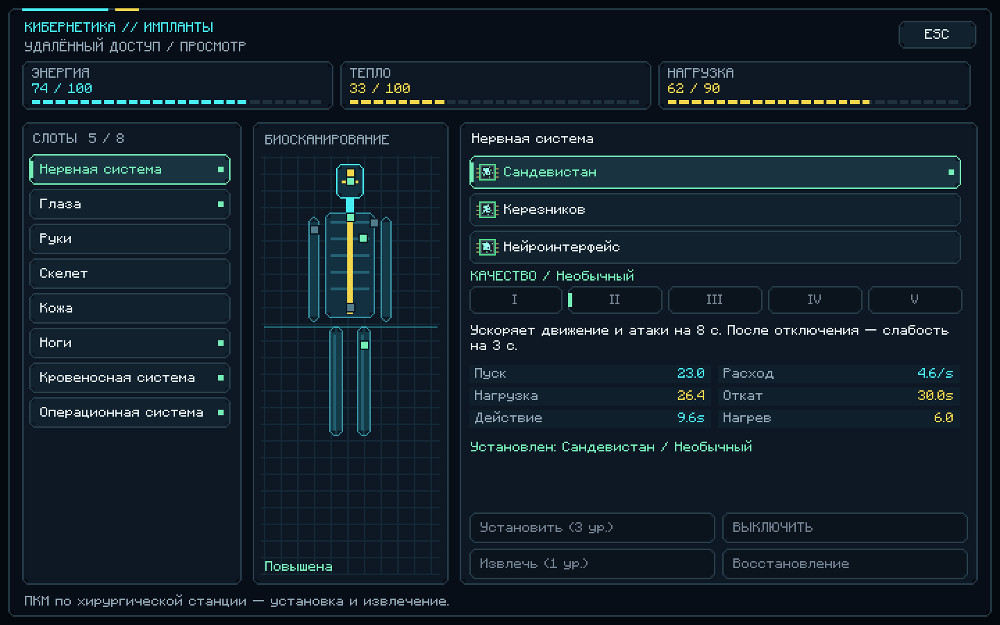

# Cybernetic Augmentation 0.2.1

Мод для **Minecraft 1.21.1 + NeoForge 21.1.259**, нужна **Java 21**.

## Скачать

- [Скачать JAR 0.2.1](https://github.com/fogcer23-ctrl/Modminetcraftsuperpupercyberpuck/raw/refs/heads/downloads/cybernetic_augmentation-0.2.1.jar)
- [Скачать ZIP с тем же JAR и инструкцией](https://github.com/fogcer23-ctrl/Modminetcraftsuperpupercyberpuck/raw/refs/heads/downloads/cybernetic_augmentation-0.2.1-download.zip)

Удалите предыдущий JAR Cybernetic Augmentation из `mods`, затем положите новый файл. Для сетевой игры обновите одинаковый JAR на клиенте и сервере. Формат данных имплантов версии 1 сохранён.

## Исправления 0.2.1

- Устранены совпадающие рецепты: доступны все 23 обычных импланта и 92 улучшения.
- Исправлены сохранение состояния, предельные таймеры, отключение при перегреве и ёмкость после извлечения энергоядра.
- Переименованные импланты распознаются в инвентаре и второй руке; установка и извлечение сохраняют имя и компоненты предмета.
- Нажатия клавиш из меню не вызывают отложенные активации. Исправлены фокус, дробная прокрутка и отображение расхода при перегрузке.
- Повторный вход не сбрасывает дополнительный прыжок и штраф Сандевистана. Эффекты правильно переносятся при возвращении из Края.
- Ночное зрение и невидимость имплантов снимаются сразу при выключении; обычные эффекты зелий и маяков сохраняются.
- Сканер учитывает прицел и препятствия; боевые способности защищают собственных питомцев, включая лошадей, и не стреляют сквозь них.
- Исправлены отмена операций в режиме наблюдателя, откаты медицинских предметов и восстановление после урона.

Киберпанк-оформление сохранено: чёткий текст, собственные угловатые кнопки, тёмные панели, бирюзовые и жёлтые акценты, биосканирование и HUD.

[Компактный экран](preview-0.2.1-compact.png) · [Предпросмотр HUD](preview-0.2.1-hud.png)

Снимки настоящего клиента используют демонстрационные состояния в меню, без входа в мир.

## Управление

**K** — управление имплантами; ПКМ по хирургической станции — установка и извлечение. **R** — нервная система, **V** — оптика, **G** — ноги, **H** — маскировка. 23 типа имплантов пяти уровней качества, энергия, перегрев и хирургия. Полная инструкция входит в ZIP.

## Проверки

Успешная сборка; **75 модульных тестов и 36 игровых серверных тестов**, без ошибок и пропусков. Проверены 119 уникальных рецептов, локализация и ссылки на ресурсы. Графический клиент прошёл проверки ввода, инвентаря, отключённого соединения и прокрутки; получены 8 снимков на масштабах GUI 1/2/3. В релизном JAR нет вспомогательного графического harness.

Длительная ручная игра в мире и настоящий мультиплеер ещё не проверены. Контрольные суммы находятся в `SHA256SUMS.txt`.

## Архив

[0.2.0 JAR](https://github.com/fogcer23-ctrl/Modminetcraftsuperpupercyberpuck/raw/refs/heads/downloads/cybernetic_augmentation-0.2.0.jar) · [0.2.0 ZIP](https://github.com/fogcer23-ctrl/Modminetcraftsuperpupercyberpuck/raw/refs/heads/downloads/cybernetic_augmentation-0.2.0-download.zip) · [0.1.0 JAR](https://github.com/fogcer23-ctrl/Modminetcraftsuperpupercyberpuck/raw/refs/heads/downloads/cybernetic_augmentation-0.1.0.jar) · [0.1.0 ZIP](https://github.com/fogcer23-ctrl/Modminetcraftsuperpupercyberpuck/raw/refs/heads/downloads/cybernetic_augmentation-0.1.0-download.zip)
